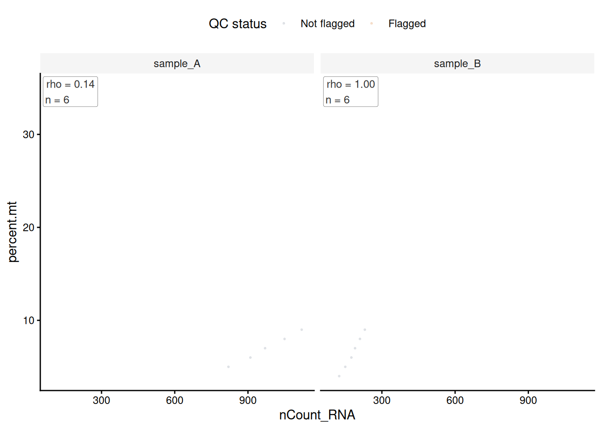

# Interpreting MAD QC flags

[`mad_qc()`](https://thokas99.github.io/veryMAD/reference/mad_qc.md)
flags selected tails of numeric metrics. A flag is evidence of
statistical atypicality within the supplied reference distribution, not
a diagnosis of cell quality.

| Direction | Flagged values        |
|-----------|-----------------------|
| `lower`   | Below the lower limit |
| `upper`   | Above the upper limit |
| `both`    | Outside either limit  |

Limits are estimated as the median plus or minus `nmads` scaled MADs
after any transformation. By default, `nmads = 3` and the MAD constant
is 1.4826.

## Missing values and threshold status

Missing metric values receive `NA` flags. The combined flag is `TRUE` if
any metric is flagged; if none is flagged, it is `NA` when any metric
flag is unresolved. Because the combined flag uses an OR rule, its
flagged fraction can rise as more metrics are included. Review
per-metric counts alongside it.

The example uses percentage points for `pct_mito`: 8 denotes 8%.

``` r
qc_metadata <- data.frame(
  sample = paste0("sample_", 1:7),
  library_size = c(2.4e6, 2.5e6, 2.6e6, 2.7e6, 2.8e6, 0.5e6, NA_real_),
  detected_genes = c(12000, 12500, 13100, 12800, 13400, 1600, 12200),
  pct_mito = c(4, 5, 6, 5, 7, 8, 30)
)

qc_result <- mad_qc(
  qc_metadata,
  metrics = c(
    library_size = "lower",
    detected_genes = "lower",
    pct_mito = "upper"
  ),
  output = "report",
  verbose = FALSE
)

qc_result$flags[, c("id", "library_size", "detected_genes",
                    "pct_mito", "mad_qc_outlier")]
#>   id library_size detected_genes pct_mito mad_qc_outlier
#> 1  1        FALSE          FALSE    FALSE          FALSE
#> 2  2        FALSE          FALSE    FALSE          FALSE
#> 3  3        FALSE          FALSE    FALSE          FALSE
#> 4  4        FALSE          FALSE    FALSE          FALSE
#> 5  5        FALSE          FALSE    FALSE          FALSE
#> 6  6         TRUE           TRUE    FALSE           TRUE
#> 7  7           NA          FALSE     TRUE           TRUE
```

The threshold report gives `status`, limits on raw and transformed
scales, and counts of reference, flagged, and unresolved observations.

``` r
transformed_result <- mad_qc(
  qc_metadata,
  metrics = c(library_size = "lower", pct_mito = "upper"),
  transform = c(library_size = "log1p"),
  output = "report",
  verbose = FALSE
)

transformed_result$thresholds[, c(
  "metric", "direction", "transform", "lower_raw", "upper_raw",
  "status", "n_used", "n_flagged", "n_unresolved"
)]
#>         metric direction transform lower_raw upper_raw status n_used n_flagged
#> 1 library_size     lower     log1p   1961998        NA     ok      6         1
#> 2     pct_mito     upper      none        NA   10.4478     ok      7         1
#>   n_unresolved
#> 1            1
#> 2            0
```

`min_n` defaults to 5 non-missing reference observations per metric and
group. Groups below this size have `insufficient_n` status; groups with
no observed values have `all_missing` status.

## Zero MAD

A zero MAD provides no estimate of non-zero spread. Choose how to handle
it:

| `zero_mad` | Behavior in [`mad_qc()`](https://thokas99.github.io/veryMAD/reference/mad_qc.md) |
|----|----|
| `"na"` (default) | Leave flags unresolved |
| `"zero"` | Set the selected limit at the median and flag values beyond it |
| `"error"` | Stop |

## RNA and ATAC metrics

The following directions are common starting points, not universal
rules. Metric definitions and their relationship to biology depend on
the assay, protocol, and sample.

| Modality | Example metric | Example direction | Example transformation |
|----|----|----|----|
| RNA | `nCount_RNA`, `nFeature_RNA` | `lower` | `log1p` |
| RNA | `percent.mt` | `upper` | `none` |
| ATAC | `nCount_peaks` | `lower` | `log1p` |
| ATAC | `TSS.enrichment` | `lower` | `none` |
| ATAC | `nucleosome_signal` | `upper` | `none` |

For example, in droplet RNA-seq, mitochondrial percentage can reflect
cell damage, but it may also vary with cell type or biological state.
ATAC metrics also depend on how peaks, TSS enrichment, and nucleosome
signal were defined. Inspect distributions by sample and known cell
groups before filtering.

``` r
rna_metadata <- data.frame(
  sample = rep(c("sample_A", "sample_B"), each = 6),
  nCount_RNA = c(820, 910, 970, 1050, 1120, 100, 125, 150, 175, 190, 210, 230),
  nFeature_RNA = c(430, 480, 520, 570, 610, 55, 80, 95, 100, 115, 125, 140),
  percent.mt = c(5, 6, 7, 8, 9, 35, 4, 5, 6, 7, 8, 9)
)

rna_report <- mad_qc(
  rna_metadata,
  metrics = c(
    nCount_RNA = "lower",
    nFeature_RNA = "lower",
    percent.mt = "upper"
  ),
  transform = c(nCount_RNA = "log1p", nFeature_RNA = "log1p"),
  output = "report",
  verbose = FALSE
)

rna_report$thresholds[, c("metric", "direction", "transform", "status")]
#>         metric direction transform status
#> 1   nCount_RNA     lower     log1p     ok
#> 2 nFeature_RNA     lower     log1p     ok
#> 3   percent.mt     upper      none     ok
```

``` r
atac_metadata <- data.frame(
  nCount_peaks = c(1200, 1800, 3200, 6000, 9000, 20000, 2500, 4100),
  TSS.enrichment = c(0.8, 1.3, 3.0, 5.4, 8.0, 15.0, 4.1, 6.2),
  nucleosome_signal = c(3.5, 2.4, 1.8, 1.4, 1.1, 0.9, 1.6, 1.3)
)

atac_report <- mad_qc(
  atac_metadata,
  metrics = c(
    nCount_peaks = "lower",
    TSS.enrichment = "lower",
    nucleosome_signal = "upper"
  ),
  transform = c(nCount_peaks = "log1p"),
  output = "report",
  verbose = FALSE
)

atac_report$thresholds[, c("metric", "direction", "transform", "status")]
#>              metric direction transform status
#> 1      nCount_peaks     lower     log1p     ok
#> 2    TSS.enrichment     lower      none     ok
#> 3 nucleosome_signal     upper      none     ok
```

## Batch and reference thresholds

`batch` estimates limits separately within each label. `subset` selects
the reference observations used in each group; flags are still returned
for all observations. Define a reference set independently of the QC
metrics when possible, since metric-based selection can bias the limits.

> **Warning**
>
> MAD limits describe the reference distribution, not an external
> quality standard. If most reference cells are poor, their values still
> define the baseline. Batch-specific limits can also miss a uniform
> shift across a batch. Inspect distributions by batch and cell type;
> add absolute criteria only when supported by the assay or protocol.
> [OSCA basic discusses these adaptive QC
> assumptions](https://bioconductor.org/books/3.23/OSCA.basic/quality-control.html#quality-control-motivation).

The 416B [OSCA
workflow](https://bioconductor.org/books/3.23/OSCA.workflows/lun-416b-cell-line-smart-seq2.html#quality-control)
illustrates QC metrics across plates with batch information. `veryMAD`
uses MAD-based thresholds on supplied metrics; it does not reproduce
[`scuttle::quickPerCellQC()`](https://rdrr.io/pkg/scuttle/man/quickPerCellQC.html).

``` r
rna_annotated <- mad_qc(
  rna_metadata,
  metrics = c(
    nCount_RNA = "lower",
    nFeature_RNA = "lower",
    percent.mt = "upper"
  ),
  transform = c(nCount_RNA = "log1p", nFeature_RNA = "log1p"),
  batch = rna_metadata$sample,
  verbose = FALSE
)

if (requireNamespace("ggplot2", quietly = TRUE)) {
  plot_mad_qc(rna_annotated,
              c("nCount_RNA", "nFeature_RNA", "percent.mt"),
              batch = rna_metadata$sample)

  plot_mad_qc_scatter(rna_annotated, "nCount_RNA", "percent.mt",
                      batch = rna_metadata$sample)
}
```



The scatter plot reports descriptive Spearman correlations and
finite-pair counts within each sample. It omits p-values because cells
are not independent experimental replicates; interpret rho
descriptively.

## Seurat metadata

[`mad_qc()`](https://thokas99.github.io/veryMAD/reference/mad_qc.md)
accepts a Seurat object and adds flags to cell metadata; it does not
calculate QC metrics. For mitochondrial percentage, define a species-
and assay-appropriate feature set and use
[`Seurat::PercentageFeatureSet()`](https://satijalab.org/seurat/reference/percentagefeatureset)
with the intended assay. Check feature identifiers and denominator: the
function divides selected-feature counts by all counts in the chosen
assay and reports 0–100%.

This synthetic example checks that annotation preserves cell order and
accepts a reference set defined before QC.

``` r
if (requireNamespace("SeuratObject", quietly = TRUE)) {
  counts <- Matrix::Matrix(
    seq_len(40) %% 6,
    nrow = 5,
    sparse = TRUE,
    dimnames = list(paste0("gene-", 1:5), paste0("cell-", 1:8))
  )
  seurat_object <- SeuratObject::CreateSeuratObject(counts = counts)
  seurat_object[["percent.mt"]] <- c(4, 5, 6, 7, 8, 9, 10, 30)
  seurat_object$sample <- rep(c("sample_A", "sample_B"), each = 4)
  seurat_object$reference_cells <- c(TRUE, TRUE, TRUE, FALSE,
                                     TRUE, TRUE, TRUE, FALSE)
  cell_ids <- colnames(seurat_object)

  seurat_annotated <- mad_qc(
    seurat_object,
    metrics = c(
      nCount_RNA = "lower",
      nFeature_RNA = "lower",
      percent.mt = "upper"
    ),
    transform = c(nCount_RNA = "log1p", nFeature_RNA = "log1p"),
    batch = seurat_object$sample,
    subset = seurat_object$reference_cells,
    min_n = 3,
    verbose = FALSE
  )

  stopifnot(identical(rownames(seurat_annotated[[]]), cell_ids))
  head(seurat_annotated[[]][, c("nCount_RNA", "nFeature_RNA",
                                "percent.mt", "mad_qc_outlier")])
}
#>        nCount_RNA nFeature_RNA percent.mt mad_qc_outlier
#> cell-1         15            5          4             NA
#> cell-2         10            4          5             NA
#> cell-3         11            4          6             NA
#> cell-4         12            4          7             NA
#> cell-5         13            4          8             NA
#> cell-6         14            4          9             NA
```

For a larger simulated example with batch-specific plots and raw-scale
thresholds, see [QC
plots](https://thokas99.github.io/veryMAD/articles/qc-plots.qmd).
