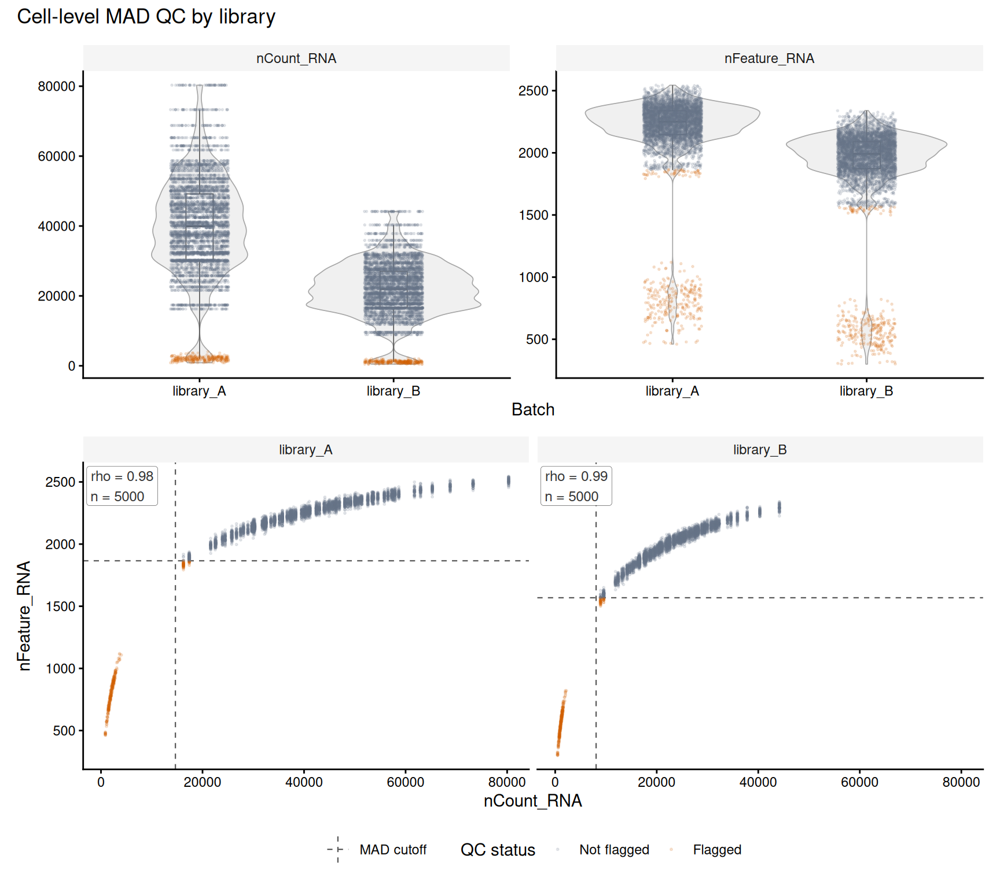

# Inspect MAD QC plots

[`plot_mad_qc()`](https://thokas99.github.io/veryMAD/reference/plot_mad_qc.md)
shows metric distributions and QC flags by group.
[`plot_mad_qc_scatter()`](https://thokas99.github.io/veryMAD/reference/plot_mad_qc_scatter.md)
shows paired metrics, estimated MAD limits, and within-group Spearman
rho. Both return `ggplot` objects. The violin, boxplot, cutoff, and
composition choices draw on the [scCustomize QC
guide](https://samuel-marsh.github.io/scCustomize/articles/QC_Plots.html).
For threshold interpretation and Seurat metadata, see [Interpreting MAD
QC
flags](https://thokas99.github.io/veryMAD/articles/qc-interpretation.qmd).

[SPARSim](https://gitlab.com/sysbiobig/sparsim) is hosted on GitLab.
Install it with `devtools::install_gitlab("sysbiobig/sparsim")` before
rendering this vignette. The simulator generates count data from
expression intensity, variability, and library-size parameters ([Baruzzo
et al., 2020](https://doi.org/10.1093/bioinformatics/btz752)).

## Simulate two libraries

The example uses 5,000 cells per library (10,000 total) and one Bacher
preset, so both libraries share gene intensity and variability
parameters. To keep rendering tractable, it samples 5,000 genes and sets
read depth to 1% of the preset. Library B uses 55% of library A’s size;
5% of cells in each library have deliberately reduced size. These
contrasts illustrate plotting and threshold behavior; they do not model
general cell damage or benchmark biological QC.

``` r

data("Bacher_param_preset", package = "SPARSim")
reference <- Bacher_param_preset[["Bacher_C1"]]
gene_subset <- sample(seq_along(reference$intensity), 5000L)
reference_intensity <- reference$intensity[gene_subset]
reference_variability <- reference$variability[gene_subset]

n_cells <- 5000L
low_depth_cells <- seq_len(n_cells %/% 20L)
library_size <- sample(reference$lib_size, n_cells, replace = TRUE)
library_size_A <- as.integer(round(library_size * 0.01))
library_size_B <- as.integer(round(library_size_A * 0.55))
library_size_A[low_depth_cells] <- round(library_size_A[low_depth_cells] * 0.05)
library_size_B[low_depth_cells] <- round(library_size_B[low_depth_cells] * 0.05)
library_size_A <- pmax(1L, library_size_A)
library_size_B <- pmax(1L, library_size_B)

cells_A <- paste0("library_A_cell_", seq_len(n_cells))
cells_B <- paste0("library_B_cell_", seq_len(n_cells))
parameter_A <- SPARSim::SPARSim_create_simulation_parameter(
  intensity = reference_intensity,
  variability = reference_variability,
  library_size = library_size_A,
  sample_names = cells_A,
  condition_name = "library_A"
)
parameter_B <- SPARSim::SPARSim_create_simulation_parameter(
  intensity = reference_intensity,
  variability = reference_variability,
  library_size = library_size_B,
  sample_names = cells_B,
  condition_name = "library_B"
)

simulation <- SPARSim::SPARSim_simulation(
  dataset_parameter = list(library_A = parameter_A, library_B = parameter_B),
  gene_expr_simulation_seed = 2718,
  count_data_simulation_seed = 3141,
  preserve_global_rng = TRUE
)
#> Number of experimental conditions:  2 
#> Number of genes:  5000 
#> Number of cells:  10000 
#> Setting gene expression intensity...  
#> Setting gene expression variability ...  
#> Simulating biological variability ...  
#> Simulating technical variability ...
counts <- simulation$count_matrix
stopifnot(
  !is.null(colnames(counts)),
  length(colnames(counts)) == 2L * n_cells,
  !anyDuplicated(colnames(counts))
)
```

SPARSim returns raw counts with genes in rows and cells in columns.
Here, library size is the column sum and detected features are the
number of nonzero genes in each column.

``` r

library_by_cell <- c(
  stats::setNames(rep("library_A", n_cells), cells_A),
  stats::setNames(rep("library_B", n_cells), cells_B)
)
low_depth_by_cell <- c(
  stats::setNames(seq_len(n_cells) %in% low_depth_cells, cells_A),
  stats::setNames(seq_len(n_cells) %in% low_depth_cells, cells_B)
)

qc_metadata <- data.frame(
  library = unname(library_by_cell[colnames(counts)]),
  nCount_RNA = colSums(counts),
  nFeature_RNA = colSums(counts > 0),
  known_low_depth = unname(low_depth_by_cell[colnames(counts)]),
  row.names = colnames(counts)
)
```

## Annotate and inspect

Estimate lower-tail thresholds within each library. The log
transformation reduces the influence of the long right tail in
count-like metrics.

``` r

metrics <- c(nCount_RNA = "lower", nFeature_RNA = "lower")
transforms <- c(nCount_RNA = "log1p", nFeature_RNA = "log1p")

qc_annotated <- mad_qc(
  qc_metadata,
  metrics = metrics,
  transform = transforms,
  batch = qc_metadata$library,
  verbose = FALSE
)

qc_report <- mad_qc(
  qc_metadata,
  metrics = metrics,
  transform = transforms,
  batch = qc_metadata$library,
  output = "report",
  verbose = FALSE
)

qc_report$thresholds[, c(
  "metric", "batch", "lower_raw", "n_used", "n_flagged", "status"
)]
#>         metric     batch lower_raw n_used n_flagged status
#> 1   nCount_RNA library_A 14657.238   5000       250     ok
#> 2   nCount_RNA library_B  8060.770   5000       250     ok
#> 3 nFeature_RNA library_A  1865.846   5000       301     ok
#> 4 nFeature_RNA library_B  1568.392   5000       296     ok
```

The table reports the raw-scale limits and flag counts for each library.

``` r

distribution_plot <- plot_mad_qc(
  qc_annotated,
  metrics = names(metrics),
  batch = qc_metadata$library
) + ggplot2::theme(legend.position = "none")
relationship_plot <- plot_mad_qc_scatter(
  qc_annotated,
  x = "nCount_RNA",
  y = "nFeature_RNA",
  batch = qc_metadata$library,
  report = qc_report
) + ggplot2::theme(legend.position = "bottom")

(
  patchwork::wrap_plots(
    distribution_plot,
    relationship_plot,
    ncol = 1
  ) + patchwork::plot_annotation(title = "Cell-level MAD QC by library")
)
```



The scatter plot shows how depth and detected features vary together
within each library. Dashed lines mark estimated raw-scale limits. `n`
counts cells with finite metric pairs; rho is descriptive and cells are
not independent biological replicates.

The cross-tabulation shows how the combined MAD flag recovers planted
low-depth cells and flags other cells in this run. These labels
represent an imposed depth reduction, not general biological quality.

``` r

with(qc_annotated, table(library, known_low_depth, mad_qc_outlier))
#> , , mad_qc_outlier = FALSE
#> 
#>            known_low_depth
#> library     FALSE TRUE
#>   library_A  4699    0
#>   library_B  4704    0
#> 
#> , , mad_qc_outlier = TRUE
#> 
#>            known_low_depth
#> library     FALSE TRUE
#>   library_A    51  250
#>   library_B    46  250
```

> **Warning**
>
> MAD flags describe statistical atypicality within the chosen reference
> group. Per-library thresholds can flag unusual cells within a library
> while missing a shift shared by most cells in one library. Review the
> distributions and threshold table before filtering, and use
> independent sample-level evidence to assess library-wide quality.
